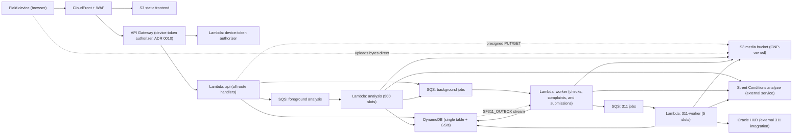
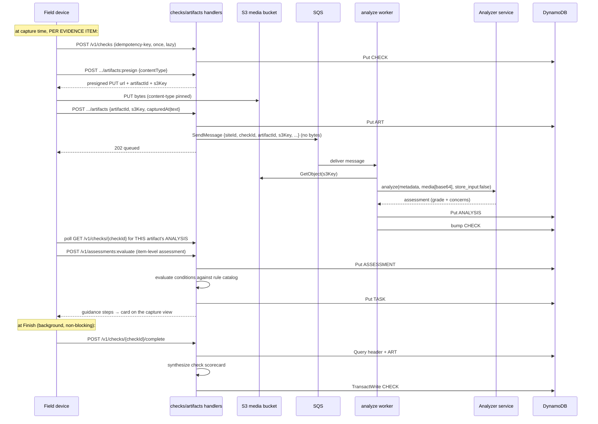

# Architecture

## Container view

The media bytes reach the analyzer only from the worker (base64, `store_input:false`);
they never travel through the SQS queue and are never logged. The perimeter-check
handlers never see the bytes either — the device PUTs straight to S3 against a
presigned URL, and the handler stores only the S3 key.

Public complaints use the same private upload boundary. The app owns complaint
authorization, lifecycle, persistence, retry, and deletion. The analyzer owns only
structured multimodal extraction through `POST /v1/complaints:extract`. JPEG, PNG,
WebP, HEIC, and HEIF images may be uploaded up to 10 MiB and are normalized before
being sent inline. PDF and UTF-8 text documents are limited to 4.5 MiB, matching the
Bedrock document ceiling, and are fetched by the analyzer through five-minute,
read-only S3 URLs with strict host and byte checks. Legacy Word `.doc` uploads are not
accepted because an OLE signature alone cannot safely validate their structure. The
analyzer does not retain complaint input.

## Compute topology (Lambdas)

The core API and processing functions (Terraform in `infra/modules/app/`), split by invocation style; bundles
are esbuild ESM outputs of `backend/scripts/build-lambdas.mjs`:

| Function | Trigger | Memory | Timeout | Role |
|---|---|---|---|---|
| `-api` | API Gateway, sync | 512 MB | 29 s | Every route handler behind one dispatch; uses unreserved account concurrency |
| `-authorizer` | API Gateway REQUEST authorizer | 256 MB | 5 s | Verifies the HS256 device token, pins `siteId`; verdicts cached 60 s by the gateway; reserved concurrency 200 |
| `-worker` | SQS and DynamoDB outbox | 1024 MB | 300 s | Background translations, complaints, submissions and outbox jobs; also drains previously queued perimeter analyses |
| `-311-worker` | Dedicated 311 SQS | 1024 MB | 300 s | Filing, attachments and closures; own role, reserved concurrency 5, batch size 1, event-source maximum concurrency 5 |
| `-analysis` | Dedicated analysis SQS | 1024 MB | 300 s | Foreground photo/text analysis; reserved concurrency 500, batch size 1, event-source maximum concurrency 500 |

Foreground evidence is routed using `ANALYSIS_QUEUE_URL`. When unset (local
harness), it falls back to `SQS_QUEUE_URL`. Both functions reuse the worker bundle
and IAM role; follow-up translations continue to use the background queue.
The analysis and submissions queues have a zero-second batching window. The background mapping retains
batch size 10 and maximum concurrency 20. The foreground reservation prevents
background work from occupying its 500 slots, but does not prewarm SQS pollers.

Deploy the analyzer's increased usage-plan and method limits (500 requests/second,
burst 1,000) before increasing caller capacity. Verify regional Lambda capacity
for **all environments' reservations plus unreserved API/analyzer/background
traffic**, and Bedrock request/token quotas. These are code ceilings, not a
measured ten-second burst guarantee. Existing queued messages drain without migration.
Each queue retains the existing retry policy (30-minute visibility, five receives)
and has backlog/DLQ alarms; both functions have error/throttle/duration monitoring.

The analysis worker
reads the photo from S3, **downscales it (sharp: EXIF-orient, fit 1568 px long
edge, JPEG q80)** — bounding the base64 payload so the analyzer never sees raw
camera-resolution bytes (full-size input was rejected 413 `input_too_large` before
the downscale existed) — then calls the analyzer and writes the `ANALYSIS#` item.
From the same normalized bytes it also makes the ≤480 px WebP card thumbnail
(`media/thumbnail.js`: stored beside the original as `<key>.thumb.webp`, then recorded
on the `ART#` row as `thumbS3Key`). That work starts just before the analyzer call and
is drained before every exit, so it overlaps the analyzer's latency rather than adding
to it; it is independent of the analyzer's outcome, and a failure only means the card
shows the original (`ThumbnailFailed` metric). `presignMedia` signs the recorded key as
`thumbnailUrl` next to the original.
sharp is esbuild-`external` and copied from node_modules into each bundle that
imports it, including the API, general worker, duplicate worker and 311 worker.

## Async analyze flow

The **evidence item is the unit of analysis**. A check is a capture container — one
flat photo roll for the whole perimeter, with a single typed description as the
alternative to photos; there is no per-site list of places to walk
([ADR 0014](./adr/0014-remove-places-photo-roll.md)). Each photo (or the description) is
uploaded, registered, analyzed, and evaluated independently as soon as it's captured —
results appear on the capture screen as they land, without waiting for the walk to
finish. Finish unlocks at one photo or one description of at least 20 characters; the rule is client-side
(`frontend/src/domain/check-completion.js`) and the backend only records the counts.
A check-level synthesis still exists, but only as the deferred, idempotent
**completion** step the client runs in the background after `Finish` (so the saved
scorecard exists for analytics/review); it never blocks or gates capture-time
guidance.

Typed descriptions register as text artifacts through the same
`.../artifacts` path (`registerArtifact` with `text`, no bytes) and flow through
the identical analyze→evaluate pipeline; the worker sends the fixed literal
`"perimeter"` as the analyzer's `position_descriptor` (there is no per-photo
position, and nothing downstream decides on it). Duplicate or overlapping tasks are
acceptable — two photos of the same issue may each produce tasks; deciding what
to keep belongs to the user.

A retryable analyzer error re-throws so SQS redelivers (then dead-letters); a
permanent failure is recorded as an `ANALYSIS#` marker with `status:"failed"`
(no concerns), which check synthesis excludes from scoring but `getCheck`
still surfaces. The client's per-item poll (`photo-analysis.js`) bounds a stuck
analyzer with a timeout; the check-level `complete` runs a **coverage gate**
(every registered artifact must have an ANALYSIS# item, analyzed or failed
marker) before synthesizing, and is idempotent-once so re-completion is a no-op.

## Public complaint flow

The browser uploads up to five validated complaint files directly to the dedicated
complaint-evidence S3 bucket and registers their metadata. Submission retags every
object while the header remains a draft, then transactionally publishes the Site-scoped
`COMPLAINT#` header and extends every artifact row's retention. The API immediately
returns an `analyzing` row and enqueues an IDs-only SQS message. The complaint worker
loads the evidence, calls the analyzer's complaint-extraction contract, validates the
six required string fields, and updates the row to `ready`. After the fifth failed SQS
delivery it records `analysis_failed`; the UI exposes an explicit retry. Confirmed
deletion removes every S3 object before deleting DynamoDB metadata. Complaint objects
and records carry a one-year lifecycle/TTL; unsubmitted draft uploads retain the
one-day pending lifecycle. The separate bucket preserves the check/task photo
bucket's unconditional 30-day retention backstop.

## Site address lookup and validation

The City admin suggests Site addresses through an authenticated
`POST /admin/v1/address-suggestions` endpoint. The browser debounces input and
the API proxies the query to Photon's public OpenStreetMap-backed service,
bounded to San Francisco and limited to five house-address results. The browser
does not contact Photon directly, and a manual-entry path remains available
because the public endpoint has no uptime guarantee.

Selecting a suggestion only fills the editable Street address, City, State, and
ZIP fields. Saving remains authoritative: the backend formats those fields and
uses the U.S. Census geocoder to validate the complete address and derive the
Site coordinates. Photon results are therefore suggestions, not trusted stored
coordinates.

## Guidance workflow (rule-driven tasks)

Guidance is evaluated **per evidence item** at capture time: `POST /v1/assessments:evaluate`
is called by the client once that item's analysis lands, with an item-level assessment built
from the single analysis. The endpoint persists an `ASSESSMENT#` report plus one `COND#`
item per condition of concern, evaluates each against a versioned rule catalog (normalized
from the product's `actions-escalations-rules` CSV), and immediately creates `TASK#` items
for rules that resolve from category + severity alone. Conditions needing user answers
return question steps; answer submission re-evaluates the condition and creates its task
then. Because each photo is its own analysis unit, two photos of the same issue can
legitimately produce two tasks — deduplication is a user curation decision, not a
system one.

Key properties, all built (`backend/src/analysis/guidance/` + `handlers/guidance.js`):

- **Deterministic, point-in-time, auditable:** each task keeps its `ruleId` +
  `policyVersion` forever; rulebase updates ship as new catalog versions (`actions-escalations-v3.js`),
  validated in CI (`npm run policy:validate`), diffed semantically with fixture impact
  reports (`npm run policy:diff`). The changelog is
  [guidance-policy-changelog.md](./guidance-policy-changelog.md).
- **Category resolution:** analyzer category labels → canonical rule categories via aliases;
  unresolved categories become `manual_review`, never a guess (safety-critical rules).
- **Ticket location resolution:** capture requests a fresh device location for each photo or
  text report but never waits for it: a reading ready at upload rides along, and a later one
  goes to `PATCH /v1/checks/{checkId}/artifacts/{artifactId}/location`, which updates the
  `ART#` row and the photo's tasks not yet filed in one transaction. 311 filing uses the task's location, then
  its source artifact's, then the site's geocoded default location from
  `SITE#<siteId> / #META`. With none it fails the app action with a retryable
  `missing_location` result rather than guessing.
- **Classifier-backed 311 routing:** the app sends the task's source image to the constrained
  analyzer classifier when one exists, otherwise it sends the original text artifact. Images use
  the same orientation correction, 1568 px long-edge cap, flattening, and JPEG normalization as
  the main analysis path before base64 encoding. The classifier returns only approved labels,
  which the app maps to SF311 service codes. An empty label result is stored explicitly as
  `insufficient_classifier_information`; the app does not guess a fallback code. Description-only
  tickets proceed to CreateSR without an attachment once a label maps successfully. This requires
  the analyzer classifier endpoint to accept the `{text}` request variant alongside its existing
  `{image}` variant.
- **Safety ordering:** emergency outcomes (911) always precede routine guidance; the analyzer
  returns metadata only — it never places calls or files tickets itself. 311 tickets are filed
  and closed by the app-action layer (not the analyzer): informational tickets filed under the
  app's own agency id 76 are closed via `UpdateSR` when the task is completed through the done
  path; tickets filed for city-handled work stay under the city's management. The 311
  team confirmed that repeated closure updates are safe and tickets owned by our
  agency are absent from `GetLatestUpdatesBySourceAgency`. Closures therefore go
  directly to `UpdateSR`, including retries after an uncertain response. Successful
  closes are checkpointed onto the task (merged into `appActionResults`, conditioned
  on the completion lease), and confirmed closures are skipped on recovery.
  `CreateSR` remains non-idempotent: an uncertain creation must not be blindly retried.
- **Task compatibility:** tasks keep `type: "onsite" | "city_escalation"` alongside the
  richer `kind`/`escalationChannel`/`appActions[]` fields.
- **In-progress issue updates:** each versioned guidance rule snapshots
  `canBeInProgress` and `primaryInProgressAgency` onto its task. After the first
  successful card action, eligible tasks move from `open` to `in_progress` and
  append an immutable, actor-attributed task-update event; ineligible tasks move
  directly to `completed` and append a `task_completed` event labeled "Marked as
  complete" with the completion timestamp and actor. The event and task status
  are committed in one transaction. History timelines derive this entry from
  `completedAt` for older direct completions without an event, once all event
  pages are loaded. Routing never depends on user-facing button text.
  Every in-progress card and its issue timeline offer a permanent "Mark as resolved"
  action (`issue_resolved`), including while awaiting a City response. This replaces
  periodic presence prompts. Optional resolution documentation opens immediately;
  the status change, timeline event, and history refresh proceed independently.
  Resolving normally moves the task
  irreversibly to `completed`; automatic closure of app-owned informational 311
  tickets runs in the background and does not delay or undo that resolution. Notes,
  actions, and update photos append to the timeline. Update-photo registration
  reuses the private artifact/S3 read path but does not enqueue analyzer work.
- **Automatic 311 work:** task creation (including clarification answers and action
  overrides) and resolution atomically write an `SF311_OUTBOX` item with
  the task change. DynamoDB Streams dispatches it to the dedicated 311 queue;
  the local harness polls the same outbox. Classification, ticket creation,
  attachment uploads, and automatic closure never gate these HTTP responses.
  `SF311_LOCK#<taskId>` stores a separate expiring worker lease and durable
  integration results, so foreground task replacements cannot erase checkpoints.
  Workers merge integration fields into the latest task without replacing user
  status or notes. Transient failures retry through the 311 queue and its DLQ,
  using 30-second exponential backoff capped at 15 minutes. Lease contention
  waits at least until the active six-minute lease expires. This per-message
  delay leaves the queue's default processing visibility timeout unchanged.
  Definitive `missing_location` and `insufficient_classifier_information` failures
  are saved with job status `failed` and acknowledged rather than retried. A separately queued new
  job can try again after its input is corrected; existing action-selection guards
  still apply when durable worker results exist. Uncertain City outcomes are never classified as
  permanent validation failures.
  Ticket creation checkpoints an intent before the City request and the returned
  SR number before attachments. An uncertain creation outcome is not blindly
  retried: operators must reconcile the stored SourceRequestID with City records
  before redrive, supplying the confirmed ticket or clearing the pending intent
  only after confirming no ticket exists. Attachments likewise checkpoint each
  pending intent (a SHA-256 hash of the media URL, not its bearer token) and each
  accepted result. On retry, an exact attachment URL match in City updates confirms
  acceptance; missing or unavailable evidence leaves the attachment pending for
  reconciliation instead of resending. Operators must confirm acceptance or
  non-submission before correcting the durable checkpoint and redriving the job.
  Closure retries reconcile City state. Previously dispatched submissions messages
  stay on their original queue and remain supported by the general worker.
  Connection failures, blocked reconciliation and terminal action failures have
  separate alarms; see the [311 runbook](runbooks/sf311.md).
- **Tapped 311 filing (`GNP_311_ASYNC_FILING`, on in dev, off by default):** a "File 311
  ticket" tap makes no HUB call. One transaction moves the task to `in_progress` with
  `appActionStatus: "queued"` and writes an `SF311_OUTBOX` job with phase `filed-<id>`
  and `trigger: "user_confirmed"`. The same worker, lease and
  checkpoints run the task's user-confirmed actions. When filed, it writes the "311 ticket
  filed" timeline entry and completes tasks that cannot be in progress, as the in-request
  path did. Transient failures go back to `queued` and retry with the same backoff;
  permanent failures, outcomes that need reconciliation, and the fifth delivery mark the
  filing `failed`, leaving the task `in_progress`. A repeat tap returns the task; a tap on a
  failed filing queues a new job.
  Action-selection overrides atomically compare the task and worker-result snapshots.
  They allow settled silent filings and definitive rejections once the results are
  reflected on the task, preserving all ticket references and checkpoints. Active
  worker claims, uncertain outcomes, and executed user actions still block edits.
  Silent and deliberate filing results are kept separately; a deliberate filing
  after a silent one uses its own source request ID and cannot reuse the silent ticket.
  Its first deliberate acceptance reads the Site delivery setting independently of
  silent history. Background jobs retain all results but do not retry proven no-ticket
  silent failures after the action is replaced, or count deliberate failures as their
  own. Uncertain outcomes remain protected. Progress updates compare integration
  results as well as task state and retry once from a fresh read on conflict.
  Explicit user-confirmed filing and City-help-note actions retain their existing
  confirmation semantics. The clarification UI shows “Updating issue” only while
  saving the answer, then renders the returned issue before refreshing metadata.
- **Site-controlled deliberate 311 delivery:** `SITE#<id>/#META` stores
  `deliberate311ProductionEnabled`. New and imported Sites explicitly default to
  `true`; missing values also mean enabled. Only Boolean `false` simulates a
  user-launched filing. Automatic `task_created` notifications are unaffected.
  Acceptance consistently reads the setting and transactionally checks it while
  persisting `deliberate311DeliveryMode` and `deliberate311AcceptedAt` on the task;
  async filing jobs also carry `deliveryMode`. Retries retain that decision.
  Simulated requests bypass classifiers, City APIs and media publication, and
  retain a stable `SIM-` reference, submission timestamp and five-minute closure
  timestamp in their ticket result. Both status endpoints derive Open/Closed
  from that clock, returning closure reason `1` (Resolved) at the next normal
  refresh. No scheduled job or extra client polling is needed. Existing task
  resolution semantics are preserved. The open-ticket ticker reads “Request
  filed (simulated)”; all other field-app copy and behavior remain unchanged.
  City notes and automatic closure never send synthetic references to HUB.
  City-escalation analytics exclude simulated filings; task activity remains
  visible and raw lake records retain provenance.
  Supervisors change the setting through `PUT /admin/v1/sites/{siteId}/deliberate-311`
  with optimistic version checking and an atomic audit event. Flag changes
  affect subsequent accepted filings only. The global submission kill switch
  remains authoritative for all integration processing.
- Endpoints: `POST /v1/assessments:evaluate`, `GET /v1/assessments/{id}/guidance`,
  `POST /v1/assessments/{id}/conditions/{id}/answers`, `POST /v1/tasks/{id}/complete`,
  `GET /v1/tasks/{id}/details`, `PATCH /v1/tasks/{id}/action`,
  `POST /v1/tasks/{id}/custom-action`,
  `POST /v1/311-requests:batch`, and
  `GET /v1/tasks/{taskId}/311-requests/{srNum}`. The 311 routes verify that each site-scoped task
  owns its service-request number and return only the normalized summary and timeline fields used
  by the client. Card hydration batches visible requests so one handler invocation loads the
  agency-76 feed once; concurrent detail loads in the same Lambda environment also share an
  in-flight feed request. The raw HUB response and customer fields are never returned. A dev-only
  harness page (`frontend/dev/guidance-harness.html` — a standalone entry point outside the app
  build, served only by the dev server) exercises the flow with fixtures against the real local
  API; see [dev-commands.md](./dev-commands.md#guidance-harness-dev-only-page).

Open tasks may replace their card action with any distinct action in the task's
snapshotted category and policy catalog. The task retains its evaluated `ruleId`;
`actionOverride` records the selected rule and original rule while the executable
fields are replaced atomically. Duplicate-group edits resolve to the original task,
so every linked card shares one action. A free-text custom action either moves that
root task to `in_progress` or completes it regardless of `canBeInProgress`, and
appends the entered text to the immutable task timeline.

## Single-table data model

The application uses one DynamoDB table. Site-domain records use `pk = SITE#<siteId>`,
so a check's header, artifacts, and analyses share a prefix query (paginated as needed).
People, physical devices, directories, reporting projections and operational controls
also use non-Site partitions; the data-model reference lists their ownership rules.

See [dynamodb-data-model.md](./dynamodb-data-model.md) for the authoritative item shapes, keys,
GSIs, and access patterns.

## Security boundaries

**Auth posture:** protected field-app routes use a **REQUEST-type Lambda authorizer**
that verifies the HS256 device-token Bearer credential and current binding/session
authority (ADRs 0010, 0015, 0019, 0020). Admin routes use Cognito JWTs and Compliance
role/assignment checks. Bootstrap, recovery, health, intake and bearer-lease media
routes have explicit exceptions in `infra/modules/app/api.tf`. The
authorizer pins `siteId` server-side — requests resolve to the token's site
partition, never a body-supplied one. (Demo/test data remains disposable; see
[security-review.md](./security-review.md) for the posture details.)

- The device (not a user) authenticates: registration mints an HS256 device token
  (ADR 0010) whose site claim scopes every later request to one partition. (The
  Cognito user pool in `main.tf` serves the separate central admin console, not
  the field device.)
- `siteId` is derived server-side from the verified token/claim — never read from the request body — so a tenant can only ever address its own partition **at the application layer** (every handler resolves the partition via `deriveSiteId`). Media registration additionally requires the exact server-issued Site/check/artifact key, and media reads revalidate the stored key's Site/check prefix before signing it.
  A caller-dynamic IAM `dynamodb:LeadingKeys` condition cannot be attached to the
  shared API Lambda execution role: DynamoDB sees that role, not the JWT/device
  principal, and the same function performs central-admin/global-partition work.
  A further platform backstop therefore requires a separate tenant-only data-plane
  function/role or per-request tagged-role assumption; a static `SITE#*` condition
  would not isolate one Site from another.
- A Provider Manager still receives Site-scoped device tokens and independently
  selectable Site bindings. The provider-wide enrollment link is only a
  provisioning mechanism: redemption resolves all active Provider Sites in one
  transaction (maximum 21), and every later authorization/refresh revalidates
  the Provider membership generation and the Site's current `providerId`.
  Provider Manager lifecycle and link issuance are restricted to Compliance
  Supervisors; Compliance Managers cannot exercise this cross-Site authority.
- Manage access allows Provider Managers to issue eight-hour Site Manager or Site
  Team Member invitations for the selected Site. Named manager assignments are added
  atomically without replacing other managers. Site Managers continue issuing only
  team invitations. Provider-derived issuer authority is snapshotted and rechecked
  transactionally at redemption; invitees never inherit provider-wide authority.
  See [ADR 0018](adr/0018-provider-issued-site-invitations.md).
- The analyzer API key is a server-side credential (Secrets Manager), never sent to the device and never logged. Every analyze call sets `store_input:false`, so the analyzer retains none of our media.
- Media bytes travel only device→S3 (presigned PUT) and S3→worker→analyzer. They never pass through the SQS queue (key only) or appear in API Gateway / Lambda / worker logs.
- Lambda roles are scoped per function and avoid wildcard resource access. The check/task media bucket and the separate complaint-evidence bucket both block public access and require SSE-KMS + TLS. Every check/task photo expires 30 days after upload via a bucket-wide rule. Complaint evidence expires after one year via its own bucket-wide rule. In either bucket, uploads that were never registered or were rejected expire after one day. Bucket versioning is suspended so expired media leaves no noncurrent copy.
- Public endpoints are protected by CloudFront security headers, TLS policy, CAA DNS records, WAF managed rules, and rate limits.

## Edge routing contract (SPA fallback vs API routes)

Frontend publication uses `scripts/publish-web-assets.sh` for both the provider
and admin builds. Hashed assets upload first with immutable caching, other
resources next, and entry HTML last with revalidation. Publication retains old
assets so already-open clients can still load their original lazy modules; it
never runs `s3 sync --delete`. Source maps remain excluded from public uploads.
Removing retained assets requires a separate retention decision, not routine deploy
cleanup. A failed resource upload prevents publication of the new HTML.

Issue-card resolution starts its API request before loading the optional
notes-and-photos dialog. The card shows a pending state and confirms the saved
result independently of dialog loading. A failed form load offers a local retry
without repeating resolution or refreshing the page; another open form's unsaved
draft is preserved. Uncertain save retries reuse the same idempotency key.
The card stays mounted through the results prompt: Done or Skip closes the prompt,
then a confirmed completion uses the same slide-and-collapse animation on To-do
and In-progress before the card moves to History. Notes and photos save in the
background. Worklist refreshes preserve hydrated evidence and leave open sheets
and unchanged card markup mounted, avoiding refresh flicker.

Task-list responses include evidence type and artifact identity from a batched,
site-scoped artifact read. History uses a document icon for text, a photo preview
for images, and a neutral placeholder for unknown evidence. Media hydration keeps
that selected artifact identity so a later fetch cannot change the evidence type.

Single-issue reports share the analysis pipeline with perimeter checks, but keep
`flowType` through saved check adaptation and Home rendering. A clear single-issue
result uses the no-concerns message without the perimeter check's add-issue offer.
Site-manager check headlines, calendar bands, weekly bars, and check detail lists
count only perimeter checks. Issue reporting still includes single-issue findings;
the CSV keeps perimeter completions and single-issue reports in separate columns.

While Home is visible and online, it refreshes check summaries and the four task
status lists every ten seconds. Concurrent reads share an in-flight batch;
returning to the app refreshes immediately, and reconnect reloads the saved view.
A downward touch pull or mouse drag on card padding below the tabs at the top
of the page, or an upward wheel/trackpad overscroll there, reloads the Home lists and pending guidance. Pulling displaces
only the list below the tabs with resistance and reveals a refresh indicator.
Releasing past the threshold holds a spinner until the request finishes, then
settles the list without changing its scroll position. Short or cancelled pulls
settle without a request. Wheel gestures release after a short quiet interval,
since browsers expose no trackpad release event. Reduced-motion settings suppress
the settling animation and use a static loading indicator. Home owns a single
pull-refresh state and shared promise. Its label is rendered below the icon from
that state, so list rerenders cannot clear it. Check summaries, task lists, and
pending guidance must all finish successfully before the indicator collapses;
partial failure retains successful updates and presents one retry message.
While that failure is displayed, the background poll retries the full batch,
including guidance, and clears the message and pull offset only after success.
Background list refreshes are silent. Initial guidance loading uses skeletons,
not a separate loading label. Timers and
gesture listeners are removed when Home unmounts. This adds up to five list requests
per ten seconds per visible Home instance (150 requests per five minutes), before
changed-card hydration; include this traffic when revisiting shared-IP WAF sizing.

A note/photo update composed before another device resolves an issue can append
to the resolved task. Its resolution timestamps, completion method, and proof
remain intact, and the append does not enqueue another resolution job or send a
City-help cancellation. A concurrent write conflict reloads the task and rebuilds
the transition once; idempotency prevents duplicate timeline entries. Recoverable
311 filing completions retain their separate existing recovery behavior.

The provider frontend's CloudFront distribution has **no error-page mapping**. SPA deep links
(`/check`, `/today`, …) resolve via a viewer-request function (`aws_cloudfront_function.frontend_spa_rewrite`,
`infra/modules/app/cloudfront.tf`) that rewrites dot-less, non-API URIs to `/index.html`
*before* the S3 origin — so missing assets return real 404s and, critically, the API
origins' own 403/404 JSON responses reach the viewer untouched.

**Never re-add distribution-wide `custom_error_response` blocks** on the frontend (or admin)
distribution: they apply to *every* origin, so an API 403/404 would be rewritten into
`index.html` with status 200 — the 2026-09-14 dev incident (device-token authorizer denial
→ 200/HTML → the client treated the SPA as a successful API response). The client guards
against this class of failure (non-JSON API body other than a 429 → `ApiError(non_json_response)` in
`services/api.js`; `services/backend-health.js` probes `/health` and surfaces
OUTAGE/AUTH states), and CI's deploy smoke check fails if an API error response arrives
as anything but JSON.

WAF rate rules return **429**, JSON, `Retry-After: 300`, and `Cache-Control: no-store`.
The general viewer-IP ceiling is 30,000 requests per five minutes, shared by static
assets and API requests. It is sized for up to 100 people behind one public IP,
assuming one browser tab per person. Source-based estimates allow roughly 19,300
requests for 100 cold Today loads, pending duplicate polling, and one prolonged
analysis per person; the remaining budget covers variable assets and interactions.
This is a sizing allowance, not measured backend capacity; additional tabs or repeated
work can consume it. Direct S3 photo transfers do not use this CloudFront budget.
Endpoint viewer-IP budgets per five minutes are 1,000 for device registration/refresh,
100 for manager recovery, 1,000 for client errors, 5,000 for client events, and 100 for
feedback. They share the general traffic ceiling: a higher endpoint allowance does not
raise that ceiling. Client error reporting retains its five-reports-per-minute browser cap.
Enrollment keeps its `code_attempts_limited` error code; other rate rules use
`rate_limited`. Managed-security and body-size blocks retain their own responses.
The general rate rule can match before an endpoint rule, so clients classify throttling
by HTTP status rather than assuming a route-specific error code. The five-minute advice
is conservative, not a guarantee of admission if traffic continues.

Field and admin errors retain normalized `retryAfterMs` metadata, accepting delta seconds
or an HTTP date. A non-JSON 429 remains throttling, not an expired session or outage.
Health probes retain their current health state on 429 and defer further probes through
its cooldown. Duplicate-result polling pauses all batches, including new subscriptions and
invalidation-triggered reads, until the cooldown plus positive jitter; subscriber deadlines
still apply. Missing retry advice uses a five-minute cooldown. Other read errors retain their
existing behavior. Writes, enrollment, recovery-email requests, and feedback are never
replayed automatically because of a 429. Telemetry continues to drop rejected reports.

These edge responses apply to static assets too. A throttled document or script cannot
render an in-app wait message; no CloudFront error-page mapping substitutes a success page.

## Offline capture and sync

Perimeter checks are idempotent by design: the client mints the `checkId` (a UUID) and
sends it as the `idempotency-key`, and artifact/analysis writes are conditional, so a
replayed request can never create a duplicate. That contract is what lets checks finished
with no connection be sent later ([Offline check queue](#offline-check-queue)).

A Workbox service worker (`offlineShell` in `frontend/vite.config.js`) precaches the
built app, so it opens, reloads, and loads lazy screens with no network. It ships in every
`vite build` bundle, so both deployed environments (dev and prod) have it; the local Vite
dev server and the e2e suite never do; `npm run dev:offline` builds and previews it
locally, and `npm run test:offline:e2e` tests it there. It never intercepts API calls:
write queues live in the app, because Workbox background sync does not run on iOS.

The HTML page is network first: a launch waits up to 3 seconds for the network, then
falls back to the precached `index.html` (instantly when there is no signal), so every
online launch opens the latest release. API routes and paths with a file extension are
never answered with the page, mirroring the CloudFront SPA rewrite. Hashed JS, CSS, and
icons are served cache first from the precache. A new worker takes over as soon as it
installs; an open page keeps its loaded code, and older lazy chunks still come from S3,
which keeps previous assets.

Manager screens (site admin, access, reports) are not precached: they are not field work
and need fresh data, so offline they show the route's load error. Languages other than
English are cached only once someone loads one.

### Offline check queue

Every evidence item is saved to IndexedDB as it is captured (`state/check-session.js`).
A transport failure (no connection) does not fail an item: it is marked `waiting`,
still counts toward Finish, and shows "Waiting for connection". Real server errors and
analyzer timeouts still fail it. A weak signal counts as no connection too: an API call
still running after 30 seconds (`REQUEST_TIMEOUT_MS` in `services/api.js`), a photo
upload with no bytes moving for 30 seconds, or one slower than about 20 kB/s is
aborted as a transport failure instead of hanging.

Done keeps the check on the device as a finished record (`check:<siteId>:<checkId>` in
the `review` store) until its uploads and scorecard land, so several can wait at once.
The check on screen is `current`; others stay in memory and keep saving progress, found
by item id. `services/check-submissions.js` sends them: it restarts waiting items
through the normal per-item pipeline, which resumes from whatever already reached the
server, then builds each check's scorecard once every live item has a registered
artifact, and marks it done. Triggers are app start, `online`, `pageshow`, returning
to the app, `sitebound`, the backend recovering from an outage, and a retry every minute
while any item waits (a weak signal may never fire `online`, and the health probe backs
off to 5 minutes); an item run ending only re-checks scorecards, so an offline device
does not spin. Item runs take a cross-tab Web Lock and
skip an item another tab is already running. Home drops a finished check once the
backend history shows it.

Like care work, this is an in-app queue, not service worker background sync: sending
pauses while the app is closed and resumes when it reopens.

With no connection, home shows the last lists it loaded (saved per site in the `review`
store, cleared on sign-out) and keeps Start check available; the app-wide offline toast
says why. It reloads the live lists on `online`.

### Duplicate issue links (feature-gated; not yet deployed)

A separate DynamoDB stream dispatcher and SQS/Lambda worker perform duplicate
assessment without calling or delaying the normal analysis worker. Only the
analyzer's isolated comparison function invokes Bedrock. Matching uses same-Site,
same-category issues generated within the preceding 72 hours, all available images,
and issue descriptions; text-only evidence is supported conservatively.

Confirmed condition links map through current guidance pointers to tasks. The app
retains individual observations and uses the earliest valid original for shared
actions and the in-progress/history card. Separate frontend polling updates cards
incrementally. A durable human override restores an independent actionable report
without reversing the group's action. Details and deployment/retention controls:
[ADR 0017](adr/0017-duplicate-issue-links.md),
[duplicate operations](runbooks/duplicate-detection.md).

## Proactive care work logs

All devices bound to a Site can create and read that Site's proactive care logs
at `/care-work`. These are independent records, with no check, assessment, task,
analysis job, location capture, or reporting/compliance side effect. Seven stable
work kinds and a custom `other` kind are supported. Custom work requires a
nonblank description; fixed kinds permit an empty note and no photos. Submitted
records are immutable and have no edit/delete routes.

The client retains one submission UUID and payload across network retries. The
API conditionally creates the header and compares a payload/actor fingerprint on
replay, returning the original result for an identical retry and rejecting an
attempt to change a saved record. Reads derive the Site from the authenticated
principal. Listing uses a dedicated GSI1 partition, bounded pages, and Site-bound
cursors; the UI combines pages before computing Pacific-date groups and counts.

Photos use a distinct `care-work/<siteId>/<workId>/<photoId>` prefix in the existing
30-day uploads bucket. Upload reservations share device media quotas,
with five images, 10 MiB per image, and 25 MiB per log. Submission checks the
reservation owner, signed byte metadata, actual size and decoded image format,
then uses the existing image normalizer to strip EXIF and produce a JPEG under a
server-only `.jpg` key. Source uploads remain `state=pending` and expire after one
day; submitted JPEGs use `state=active`. The existing bucket lifecycle and all
check/task/complaint workflows are unchanged. Failed submission attempts can leave
normalized orphan JPEGs, bounded by the same 30-day bucket backstop.

Logs retain their text and photo-expiry metadata for one year. Photo access ends
30 days after reservation even if S3 lifecycle deletion is delayed; signed URL
lifetimes are capped at that boundary. The detail view explains expired photos
while continuing to display the log.

Submitting care work first commits the submission and photo blobs to IndexedDB,
then returns to the care list without waiting for uploads. The app owns the upload
operation independently of the form. Pending submissions resume when the app
reopens or connectivity returns; failed attempts remain in the list with a retry
action. Definitive validation failures also offer editing before retry. This is a
care-specific durable queue, not service worker background sync: transfers pause when the browser
closes and resume after reopening. Records are bound to the original Site and
device session, and API calls enforce the originating Site. Successful receipts
retain the server result until it appears in the list, then are removed; photo
blobs are released as soon as the save is confirmed. Explicit sign-out/reset clears
the local queue with other on-device artifacts.

Care photo UUIDs are allocated by the client before the first presign request.
Matching retries reuse the reservation without charging quota again, including
concurrent retries. Explicit reservation-expiry responses identify the affected
photo so the client can re-reserve and upload its retained file; uncertain log
submissions replay their original payload before any recovery. Per-log quotas
count live reservations using conditional revision updates, independent of
DynamoDB TTL cleanup. Daily device quotas are not refunded.

### 311 attachment image leases

Silent and manually triggered 311 filings share the same attachment path. Each
attachment receives an opaque bearer URL at `GET /v1/311-media?token=…` valid for
48 hours from issuance. This anonymous route requires a random 256-bit token;
it grants access to one image only. DynamoDB stores the SHA-256 token hash under
`pk=SF311_MEDIA#<hash>`, `sk=LEASE`, with `entityType=SF311_MEDIA_LEASE`, `s3Key`,
`sourceS3Key`, and epoch-seconds `expiresAt`. The handler enforces expiry even before DynamoDB
TTL removes the record, then redirects valid requests to a fresh S3 GET URL
capped to five minutes or the remaining lease, whichever is shorter. Responses
are not cached. Each lease references a fresh `sf311-media/` snapshot in the uploads
bucket. These copies expire after three days, independently of the source's
30-day window, and do not inherit pending/rejected lifecycle tags. A source
that is already missing cannot receive a lease. Revocation deletes the lease
and its snapshot; deleting only the source does not revoke an issued snapshot.
See the [media safeguards runbook](runbooks/media-safeguards.md#311-attachment-leases).

This indirection avoids S3 URLs expiring early with Lambda's temporary AWS
credentials. Both the API and worker receive `SF311_MEDIA_BASE_URL` from
Terraform (the dedicated `media.<frontend-domain>` CloudFront origin). This
separate distribution uses a DNS-validated certificate with TLS 1.2 minimum,
WAF/rate limits, disabled caching, restrictive CSP, HSTS, and `no-referrer`.
It omits standard access logging because query strings contain bearer tokens;
API Gateway records request IDs, route keys, and status without queries, and
never the viewer IP address (device subject and site, or the admin's Cognito
sub, stand in for it). Media
handlers also return security headers on direct-origin success and error
responses. Local development sets a reachable API or tunnel origin, with
`S3_PUBLIC_PRESIGN_ENDPOINT` pointing at the public MinIO proxy for redirects. Existing URLs already sent to 311 retain their original expiry.
Do not log bearer tokens, full lease URLs, or redirect URLs.

### Compliance dashboard reads and navigation

The dashboard bootstraps authentication and capabilities separately from entity
catalogs. Manage users and System Status do not load providers or sites. Entity
screens load their catalogs on demand; directories request
`GET /admin/v1/providers?directory=1`, which returns site metadata and roster
summaries without reading compliance history or signing document URLs. The
backend follows DynamoDB pagination and limits directory work to three workers.
This reduces HTTP fan-out; it is not a materialized directory index, and database
read cost still grows with the number of sites.

Site reads support `view=details|oversight|access|compliance|status|letters` on the
existing authenticated site route. The default response remains compatible with
older clients. Each section fetches its required data; recently loaded sections
of the same site can be reused for 30 seconds. Writes invalidate affected section
state, and access operations reread membership, grant, and device state. Cached UI
permissions never authorize a write: backend authorization remains authoritative.

Letter polling uses status-only responses, backs off, skips hidden-tab reads,
and never retries the send. Document links are signed when the letters section
is expanded. Email history loads in pages of 20 using a cursor scoped to the site.
Search results, import progress, and letter updates preserve unrelated form DOM.
System Status is loaded as a separate module and retains its loaded pages between
subviews, invalidating them when summary counts or the reporting window change.

Concurrent identical reads can share a request, but writes invalidate pending
read sharing both before dispatch and after completion. Explicitly fresh status
reads and cancellable requests bypass sharing. Network requests are bounded at
60 seconds for GETs and 120 seconds for other methods, with no automatic mutation
retry. Navigation guards discard obsolete responses; Analytics cancels superseded
queries and caches up to ten recent parameterized results for 60 seconds. Its Run
button always requests a fresh result.

Regression checks include `npm run test:admin`, backend tests, and
`npm run test:status:e2e` (dashboard loading/navigation and System Status browser
tests). Request counts are a diagnostic, not a production latency guarantee.

### Perimeter evidence recovery

Perimeter photos and text use the existing device-held check records as their
recovery queue. Evidence and recovery checkpoints are confirmed in IndexedDB
before network work; check snapshots are written in order. A failed local write
must never be presented as a confirmed device save.

`evidence-recovery.js` limits photo transfer pipelines (reservation, S3 PUT,
registration) to two concurrent slots. The queue is FIFO in a tab and uses two
origin-wide Web Lock slots where supported. Browsers without Web Locks retain
the per-tab limit and server idempotency protection. Polling and guidance do not
hold a transfer slot. Per-item ownership is acquired before manual or automatic
work, and requests remain bound to their original site.

Transient client-stage failures receive three automatic retries after the
initial attempt, with jittered exponential delays starting at two seconds and
respect for Retry-After. Recovery records retain stage, attempts, state, and next
attempt time across reloads. Connection interruptions pause this budget. App
startup, restoration, connection recovery, and scheduled due times resume work;
closed apps do not send. An exhausted budget remains exhausted after reconnect.
Manual recovery starts one new bounded cycle and cannot overlap an active run.
Permanent failures do not expose a generic Retry.

The upload reservation identity is stable. Once bytes are confirmed uploaded,
recovery skips the PUT and retries registration. Text artifact identities are
saved before registration. Successful analysis is retained before guidance, so
guidance recovery does not request another analysis. Polling windows time out
after three minutes, then schedule observation again after 15 seconds; timing
out never restarts server analysis. The existing per-check poll shares reads.

Artifacts carry an analysis generation and lifecycle status. Workers claim a
bounded lease, and atomically publish the analysis plus its terminal artifact
status with a generation condition. Transient server failures retain SQS's five
delivery budget. A final failed delivery, or the analysis DLQ consumer after a
hard timeout, publishes retryable exhaustion. Permanent failures publish a
non-retryable failure. The existing check read excludes results from older
generations. Explicit restart uses a persisted request identity, accepts only an
exhausted generation, and safely replays a lost response. Registration replay
while analysis is running or complete does not request another analysis.

Finished checks wait for evidence guidance or permanent terminal failures before
finalizing. Check-level finalization has its own durable client retry budget.
Recoverable failed uploads remain in the expected evidence count. An exhausted
finalization offers Retry saving; connectivity and operation guards also apply
to that control. The warning expires after five seconds, but its retry button
remains until the operation is retried or completed. These rules do not change task-update, phone-completion, form,
or 311 recovery policies.

Assessment publication budgets the evaluated DynamoDB transaction before
allocating task display IDs. It counts the assessment, current pointer, unique
evidence-deletion guards, actual condition and task writes, filing outbox jobs,
and any predecessor, retirement, or translation updates. It does not reserve
filing jobs for actions that need no background job. The assembled transaction
is checked again against the 100-operation ceiling. Oversized inputs are
rejected without truncating conditions or splitting atomic publication; the
64 KiB request limit still applies. A replay whose recalculated transaction is
too large first checks for already-published guidance and returns that result
using the existing visibility and dismissal rules.
