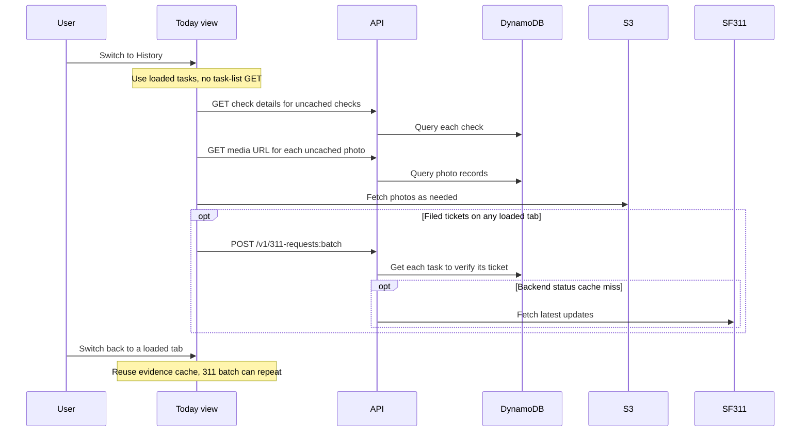
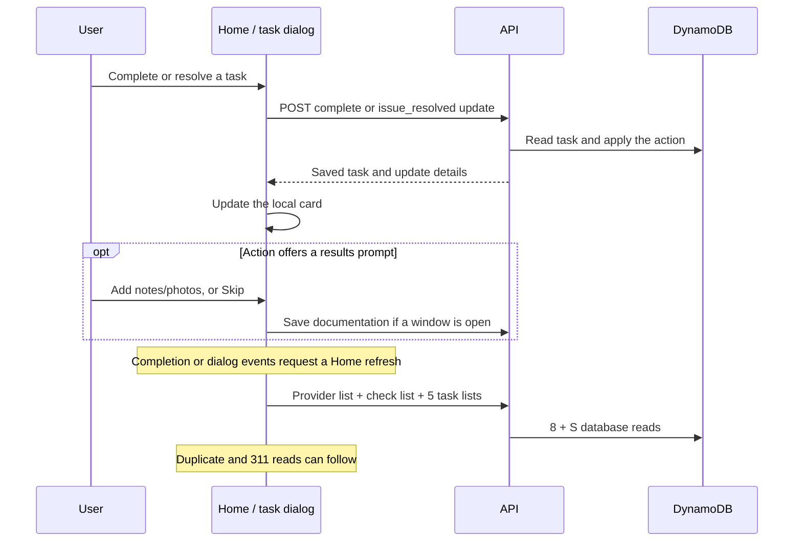

# Home activity: tabs, task close-out, and history

## Request totals

Start with [Today already loaded](./today-load-requests.md): **5 To-do tasks,
5 In-progress tasks, and 20 History tasks**. Each task has its own photo. This
page covers what the user's next clicks add. It describes current behavior,
not proposed changes.

| Action | Added browser API calls | Added database work |
| --- | --- | --- |
| First visit to another tab | 1 check-detail call per uncached source check + 1 photo-URL call per uncached photo | 1 Query per call on the normal one-page path |
| Return to a tab whose photos are loaded | 0 evidence calls after successful cached reads | 0 evidence reads |
| Any tab switch with filed 311 tickets | 1 batch per 50 filed tickets across all loaded tabs | 1 GetItem per ticket/task pair |
| One full Home refresh | **7 list calls** | **7 Queries + 1 + S GetItems** |
| Complete a To-do task | 1 completion POST, then a Home refresh; documentation may add calls | Mutation reads/writes, then refresh reads |
| Resolve an In-progress issue | 1 update POST; closing the results prompt triggers a Home refresh | Mutation reads/writes, then refresh reads |
| Open task history | 1 timeline GET + photo-URL calls + a 311 batch if needed | Timeline: normally 2 GetItems + 1 Query; media and 311 reads are extra |
| Close task history without editing | **1 full Home refresh** | Same refresh cost as above |

S is the number of active provider membership records checked. With one such
record, the seven list calls make **9 database reads**. Add duplicate reads,
311 reads, and any new photo lookups after the refresh. Access checks are extra.

For a first visit to **20 History tasks from 20 distinct checks**, the evidence
cost is **40 API calls and 40 database Queries**: 20 check details and 20 photo
URLs. The browser also loads photos as needed. Tasks sharing a check reduce
check-detail calls, even though each task has its own photo.

No click here needs a new HTML document. Task dialogs and History controls may
load JS chunks on first use. New icons and photo files add asset requests.

### Assumptions

- Valid sign-in, successful calls, no retry, and no full browser reload.
- One provider-list page and one database page per evidence lookup.
- Each photo comes from a check, not the task-update-media fallback path.
- Task lists have finished loading before the user switches tabs.
- Counts for a full refresh cover one pass. Several actions can queue more passes.
- The duplicate and 311 features may add the work called out below. They are not
  hidden inside the seven list calls.

## Switching tabs

A tab click changes the filter and redraws the loaded task lists. It does **not**
call `GET /v1/tasks` again.

It then fills in missing evidence for the selected tab. The page keeps a cache
of check details and photo URLs. Repeated visits reuse successful results.
Failed lookups can be tried again. Photo downloads are separate from API calls.

A tab click also asks for 311 status if any loaded tasks have filed tickets.
That request covers **all loaded tabs**, not just the one selected. Up to 50
pairs fit in each batch. SF311 itself is called only on a miss in the backend's
60-second cache. Even a cache hit still needs the browser API call and task reads.

Tab switches do not create a new Home duplicate watch. The existing watch
already covers tasks on all loaded tabs and keeps its own poll schedule.

## What a full Home refresh does

A refresh on the current screen fetches:

| Route | Calls | Database work |
| --- | ---: | --- |
| `GET /v1/provider-sites` | 1 | 1 GetItem + 1 Query + S GetItems |
| `GET /v1/checks?limit=30` | 1 | 1 Query |
| `GET /v1/tasks?status=…&limit=50` | 5 | 5 Queries |

The five statuses are `open`, `in_progress`, `completing`, `completed`, and
`cannot_do`. Empty lists still make calls. The provider read returns early if
there is no provider, so that case costs less.

This is a data refresh, not an app restart. It does not fetch site settings or
run a boot health probe. It keeps the page's evidence cache. The 60-second
secondary-list reuse rule applies to route returns, not these action refreshes.

After the lists arrive, Home replaces its duplicate watch and reads 311 statuses
if needed. Replacing the last duplicate watch clears its shared poll state and
starts fresh reads. If photo watchers are still active, some state can be shared.
See [duplicate polling costs](./today-load-requests.md#duplicate-checks-current-cost).

If another refresh is requested while one is running, the code marks a rerun as
needed. Several requests can share that flag. A queued rerun still makes new
calls. The four secondary lists have their own queued-load handling. Thus two
refresh triggers do not imply either one or exactly two complete seven-call
passes in every timing case.

## Closing out a task

There are two main paths. They use different routes, even though both can move
an item out of the current tab.

| User action | Mutation route | What follows |
| --- | --- | --- |
| Complete a To-do action | `POST /v1/tasks/{id}/complete` | Apply returned task locally, then refresh Home |
| Mark an In-progress issue resolved | `POST /v1/tasks/{id}/updates` with `issue_resolved` | Save resolution, offer notes/photos, then refresh when the prompt closes |

The completion route checks whether the task points to a shared duplicate issue.
It reads the target task and writes its state and timeline. Some task rules also
run app actions or queue 311 work. Those paths add reads, writes, and external
calls. There is no single database count for all close-out actions.

The update route reads the task and checks for an earlier request with the same
ID before saving the update. Resolution and City-ticket handling have their own
write paths. The counts above do not treat a POST as one database write.

Optional documentation adds its own traffic. Each new photo needs an upload URL,
an S3 PUT, and registration through `/v1/tasks/{id}/update-media`. The form then
posts notes and photo IDs to `/v1/tasks/{id}/updates/{updateId}/document`.
These photos are task evidence, not new photo-analysis jobs. Even Skip can send
a document request with empty notes/photos to close an open documentation window.

The results prompt can close before its upload and documentation work finishes.
That work may overlap the Home refresh. Phone actions, failed saves, and retries
add other paths that are outside the simple successful close-out counts.

## Opening and closing task history

Opening the updates timeline makes `GET /v1/tasks/{id}/updates`. For a task with
a check ID, the backend reads the task and check header, plus one timeline Query.
Each extra timeline page repeats those reads.

The dialog then asks for media URLs for the source photo and photos in its loaded
updates. It uses its own loading path, not Home's shared photo-URL cache. Reopening
it can therefore request URLs again. It also asks for City updates if the task
has a filed ticket. The separate 311-detail dialog fetches both its ticket detail
and the app's update timeline.

**Closing the updates timeline triggers a full Home refresh, even if the user
only read it.** The `taskupdateclosed` listener does not check whether data changed.
The separate 311-detail dialog's close handler only restores focus.

Saving within the updates dialog can trigger `taskupdated`, which also requests
a Home refresh. Closing it then requests another. The queued refresh rules above
set the actual number of network calls. We have not measured that timing here.

## Scope and sources

This is a source trace, not a live load test. The fixed read counts come from
route handlers. Mutation totals vary with the task, duplicate links, notes,
photos, and City actions. No AWS queries or changes were made.

- [Today tabs and refreshes](../frontend/src/components/today-view.js).
- [Home evidence cache](../frontend/src/services/task-evidence.js) and [API routes](../frontend/src/services/api.js).
- [Completion controls](../frontend/src/components/analysis-card-completion.js) and [dialog events](../frontend/src/components/task-sheets.js).
- [Task-update dialog](../frontend/src/components/task-update-dialog.js) and [311-detail dialog](../frontend/src/components/ticket-detail-dialog.js).
- [Task updates](../backend/src/handlers/task-updates.js), [timeline reads](../backend/src/task-updates/task-update-store.js), and [completion](../backend/src/handlers/guidance.js).
- [Task-list and 311 reads](../backend/src/handlers/tasks.js), [provider list](../backend/src/handlers/site.js), and [media reads](../backend/src/handlers/artifacts.js).
