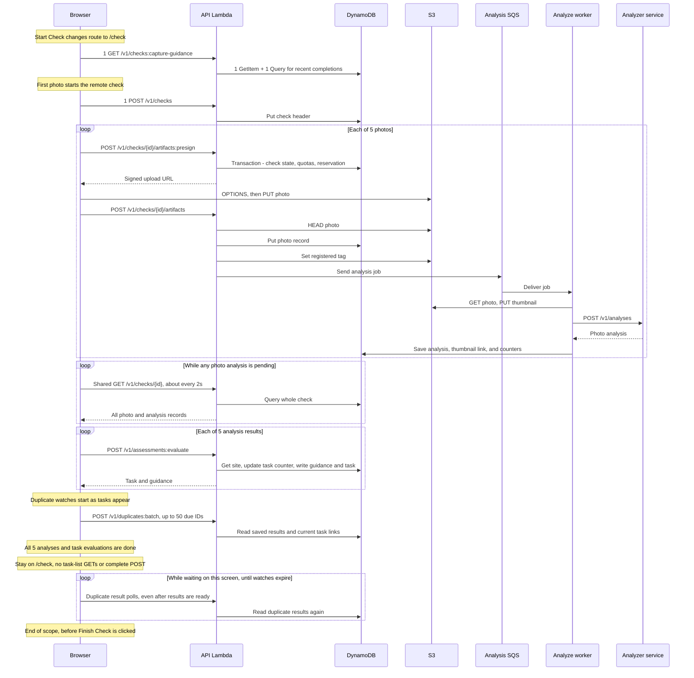

# Perimeter check: five photos, then wait on the check screen

## Request totals

Start with Today already loaded. Take **five photos** and stay on the check
screen until all five photo analyses and task evaluations finish. **Stop counting
before clicking Finish Check.** There is no return to Today in this flow.
Each photo creates one new task. All five photos belong to one check, and no
photo belongs to more than one task.

**Capture makes 7 + P explicit DynamoDB reads and 21 write calls.**
P is the number of shared check polls. Add duplicate reads, access checks, and
the background work below. A write call can change several records. These
counts are not billing units.

**New analysis results cause 0 task-list requests while this screen stays open.**
The check screen gets each task in the evaluation reply and redraws locally.

| Request type | Count | What it covers |
| --- | ---: | --- |
| New HTML document | **0** | Opening /check stays in the loaded app |
| New core JS / CSS | **0** | Capture code is already loaded; new icons may still load |
| Capture API calls | **17** | 1 starting hint + 1 create + 5 upload URLs + 5 registrations + 5 evaluations |
| Check-result API polls | **P** | Shared `GET /v1/checks/{checkId}` calls |
| Duplicate-result API polls | **Varies** | Tasks join the shared batch service as they appear |
| Photo uploads | **5 S3 PUTs** | Photo bytes go straight from browser to S3 |
| Upload preflight requests | **Normally 5 OPTIONS** | Browser checks S3 cross-origin access before the five unique upload URLs |
| Analytics API calls | **11** | 5 camera opens + 5 photo picks + 1 route page view |
| Task-list refresh calls | **0** | No Today view is mounted during capture |
| Complete-check calls | **0** | Finish Check has not been clicked |
| Main analyzer calls from the server | **5** | One `POST /v1/analyses` per photo, without retries |
| Other server calls | **Varies** | Address lookup, translation, duplicate matching, and analytics |

There is no single fixed total for this flow. The time between photos and the
worker speed set P. Duplicate polls add traffic while the user waits. The counts
exclude the [first Today load](./today-load-requests.md) and any work after Finish.

### Assumptions

- A new check, a valid sign-in, and no errors, retries, edits, or deleted photos.
- The first create request finishes before the next photo starts its pipeline.
- Each photo has one issue whose rule creates one task without a follow-up
  question. No task starts an automatic 311 job. All duplicate results end with
  no match. Duplicate checks are enabled.
- English capture, valid photo files, and successful thumbnail writes.
- Each database Query fits in one page. The starting-hint data is ready.
- Today has finished loading before Start Check. No older capture is still
  running in the background.
- Five separate camera/file-picker opens. No full browser reload during capture.
  OS camera focus changes can still add health probes.

## Request flow

API calls below pass through CloudFront and API Gateway. Each photo starts its
own pipeline as soon as it is picked. Upload and analysis can overlap across
photos. The loop groups those five pipelines; it does not mean they run one at
a time.

The diagram leaves out optional background jobs for clarity. They are counted
as separate work below, not as part of the 17 fixed API calls.

## API routes and database work

| Route | Calls | Work per call |
| --- | ---: | --- |
| `GET /v1/checks:capture-guidance` | 1 | 1 GetItem for readiness + 1 Query for the last five days of completions |
| `POST /v1/checks` | 1 | 1 PutItem for the new check |
| `POST /v1/checks/{id}/artifacts:presign` | 5 | 1 transaction: check header state, update check quota, update device quota, put upload reservation |
| `POST /v1/checks/{id}/artifacts` | 5 | S3 HEAD + 1 PutItem + S3 tag write + 1 SQS send |
| `GET /v1/checks/{id}` | P | 1 Query for the header, photos, and analyses |
| `POST /v1/assessments:evaluate` | 5 | 1 GetItem for site short codes + 1 counter UpdateItem + 1 transaction |
| `POST /v1/checks/{id}/complete` | 0 | Not called before Finish |
| `POST /v1/duplicates:batch` | Varies | Reads saved duplicate results; no model call |
| `POST /v1/client-events` | 11 in this example | No DynamoDB; forwards to PostHog if set up |

Each first evaluation writes four records in its transaction: assessment,
condition, task, and current-guidance link. Presign checks the check and device
quotas, **not a site-wide quota**.

The fixed read count is **2 for the starting hint + 5 for task IDs = 7**, then
**one Query per shared poll**. The fixed write count is **1 create + 5 presign +
5 register + 10 evaluate = 21 calls**. Those calls contain **46 record writes
and 5 transaction condition checks**. No completion read or write is included.
Failed conditions, retries, and SDK retries are outside these counts.

Access checks add reads, as in the Today doc. The transaction condition checks
are not counted as explicit GetItem or Query calls.

## Background work for five photos

This work runs while the user waits. Translation, duplicate, and status jobs
can still be running after all five photo cards show their results.

| Work | Cost in this example |
| --- | --- |
| Main photo analysis | 5 SQS jobs, 5 S3 GETs, 5 analyzer calls, 5 analysis PutItems |
| Thumbnails | 5 S3 PUTs and 5 UpdateItems to save thumbnail links |
| Check issue counters | 5 issue-count updates and 5 attempts to raise max severity; equal/lower severity can fail the condition |
| Address lookup | Up to 5 Amazon Location ReverseGeocode calls when enabled and coordinates are valid |
| Translations | Analysis and guidance can each enqueue work: up to 10 messages here; database reads/writes and analyzer translation calls vary |
| Duplicate matching | Stream dispatcher, SQS worker, database reads/writes, S3 media reads/cache, and analyzer comparison calls; cost depends on site history |
| Status records | DynamoDB stream events write reporting records; these add database writes |
| Analytics | Up to 11 PostHog calls for the 11 events above; secret reads depend on the Lambda cache |

The main analyze worker has no explicit DynamoDB read on its normal success
path. It gets the photo from S3 and writes its result. Its core work adds **20
write attempts** here: 5 analyses, 5 thumbnail links, and 10 counter updates.
This does not include the translation, duplicate, or status workers.

The app fills in missing text for four languages: Spanish, Filipino, Vietnamese,
and Traditional Chinese. The worker reads saved text. It calls `/v1/translations` for each missing
language and chunk. It then updates saved copies. Two jobs can arrive for the same photo.
Existing translations can let a later job skip the external call. Thus five
photos do not imply exactly five translation calls.

Duplicate matching is real background analysis. It reads prior observations and
may call the analyzer's comparison service. **Browser duplicate polls only read
its saved results.** Five photos do not set the number of model calls. The site history, saved work,
and results all matter. See the
[duplicate runbook](./runbooks/duplicate-detection.md) for that worker path.

The analyzer is a separate service. This repo shows the requests it sends there,
not the full database or model cost inside that service. No direct browser call
to the analyzer is needed. A rule that starts 311 work adds an outbox record,
queue work, and SF311 calls; that case is excluded from this example.

## What repeats while capturing?

**Photo-analysis polls are shared by check.** Five photos do not create five
independent two-second loops. Each photo waits for its own result. All share
the same check data.

The first read starts at once. Further reads wait about two seconds after the
last one. Each read gets the whole check, not just the newest photo. Each waiter
has a three-minute deadline. The loop ends when no waiters remain. A later
photo can start a new read. This service does not save the last result once
the loop stops. Once all five analyses have arrived, this loop stops.

**Duplicate polls are separate.** Each photo's tasks join the shared duplicate
service after guidance returns. Task IDs are deduplicated across watchers, with
up to 50 due IDs per request. Since photos finish at different times, five tasks
may join in several batches. Finished no-match results still repeat every 30
seconds. Pending results use two seconds, then five seconds. Watches last up to
15 minutes and pause while the document is hidden.

For five tasks with full current records and no matches, reading all five saved
results costs **45 GetItems**. Pending or missing records change that cost.
See [Today's duplicate cost](./today-load-requests.md#duplicate-checks-current-cost)
for the nine-read path per task.

## Do new results refresh the task list before Finish?

**No. There are no new `GET /v1/tasks` calls from these results in this flow.**

1. The route change removes Today and mounts the check screen.
2. Today removes its session listener, focus hooks, and duplicate watch.
3. Each photo result leads to one `POST /v1/assessments:evaluate`. Its reply
   already contains the new task and guidance.
4. The photo pipeline saves that reply in local session state. The check screen
   listens to that state and redraws its cards. It does not fetch a task list.
5. Duplicate replies update those same local cards. They do not fetch a task
   list either.

Only Today calls `listTasks()` in the current frontend. Even its session listener
ignores changes while a check is in progress, but that listener has already been
removed in this flow. The shared app shell does not fetch task lists when photo
analysis changes.

This also means no new provider-site list, Today check list, or home photo URL
requests are caused by arriving results. The original 30 Today tasks are not
kept in a home duplicate watch. The five new tasks have their own shared watches.
If the user left Today while its requests were still in flight, those requests
could finish after navigation. That is earlier work, not a refresh caused by a
new analysis. This example starts after Today has loaded.

## When the five results are ready

The five evaluations have returned their tasks, and the shared photo-analysis
poll has stopped. The user is still on `/check`. Duplicate polls can keep going,
even after all duplicate results are ready. If the user waits for those too,
that wait adds duplicate reads, not task-list requests.

For five separate no-match tasks, a full round of duplicate reads costs **45
GetItems**. Once all are ready, their 30-second schedule adds about **90 reads
per minute**, until their watches expire. Different due times may split those
reads across more than one HTTP request. Only include rounds that occur before
the user clicks Finish.

Clicking Finish would still return to Today right away. It would start a fresh
check read for completion, then the complete request and Today loads. That work
is outside this document's totals. Waiting on the check screen does not itself
call `/complete` or mark the server check complete.

## Location, camera, and repeat attempts

Start Check checks the user's distance from the site. It can reuse a recent
position or request one from the device. Each photo also asks for capture
coordinates when it has none, sharing a startup request if one is still running.
These device calls add no app API request. The server looks up the street
address on its own. That uses Amazon Location, as listed above.

Returning from the OS camera can fire focus or visibility events. The app can
then probe `/health`. A browser reload or lost session adds more startup work.
Photo previews in capture use local data URLs, so they do not need S3 GETs.

Very fast photo picks can overlap before `remoteStarted` is set. The code can
then attempt `POST /v1/checks` more than once with the same check ID. The backend prevents duplicate headers. The extra requests and write attempts
still cost work. Errors, manual retries, and queue redelivery also add calls; they are
not included in the success-path totals.

## Sources and checks

The create, hint, presign, and evaluation paths were checked locally
with fake data and the real handlers. No AWS calls or load tests were run.
The evaluation check produced one task and four transaction writes. Registration
and worker counts were traced in source. Full-flow counts still depend on timing and data. This is not a measured
network trace.

- [Capture view](../frontend/src/components/perimeter-check.js), [photo pipeline](../frontend/src/services/photo-analysis.js), [upload calls](../frontend/src/services/api.js).
- [Shared check polls](../frontend/src/services/check-polling.js), [completion](../frontend/src/services/submit-check.js), [Today](../frontend/src/components/today-view.js).
- [Check routes](../backend/src/handlers/checks.js), [upload routes](../backend/src/handlers/artifacts.js), [guidance writes](../backend/src/analysis/guidance/guidance-store.js).
- [Analyze worker](../backend/src/workers/analyze-artifact.js), [translations](../backend/src/workers/translate-artifact.js), [duplicate worker](../backend/src/lambda/duplicate-worker.js), [status records](../backend/src/domain/system-status.js).
- [Perimeter check data flow](./perimeter-check-data-flow.md) explains record contents and task rules in more depth.
