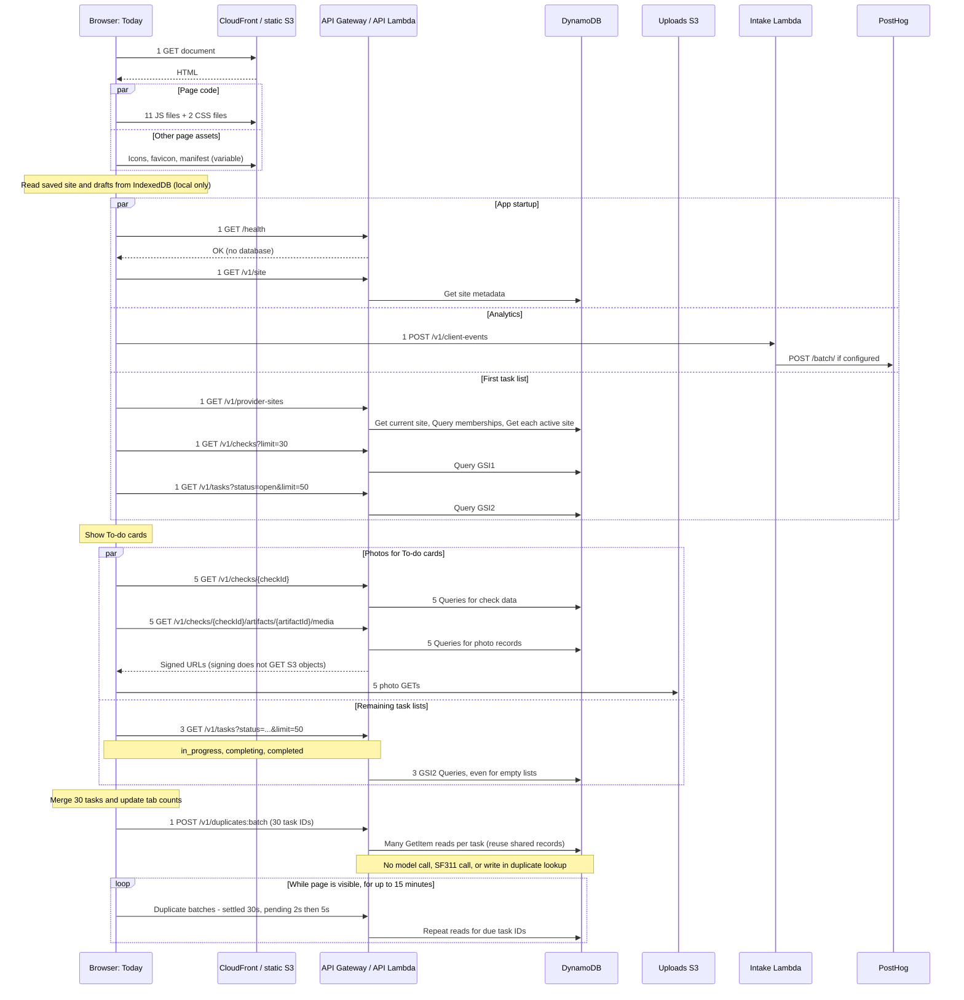

# Today: requests on page load

## Request totals

This example has **5 To-do tasks, 5 In-progress tasks, and 20 History tasks**.
The user opens Today and does not click, scroll, or switch tabs.

**DynamoDB reads for this worked example: 289 + S, plus access-check reads.**
Here, S counts active provider membership records whose site data is checked,
even if a site is then left out of the response. With one such record, that is
**290 reads**, before access checks. This assumes all 30 tasks have finished
duplicate checks with no matches, current guidance, and separate source photos.

| Database work | Initial count |
| --- | ---: |
| Duplicate result reads | **270 GetItems** |
| Other page data | **17 Queries + 2 GetItems + S site GetItems** |
| Access checks | **Extra; depends on the auth cache and user role** |
| Each repeat duplicate poll | **270 more GetItems** in this example |

These are read operations, not rows returned or billing units. A full reload
repeats the reads. The count comes from code, not a live AWS measurement.

| Request type | Count | Where it goes |
| --- | ---: | --- |
| HTML page | **1** | CloudFront; S3 serves it on a cache miss |
| JS files | **11** | CloudFront; files load in parallel as the browser finds them |
| CSS files | **2** | CloudFront |
| API calls that read DynamoDB | **19** | 8 settings/list calls + 5 check details + 5 photo URL calls + 1 duplicate batch |
| Other API calls | **2** | 1 health check + 1 page-view event |
| Task photos | **5** | S3; one photo per To-do task |
| Icons and other page assets | **Varies** | CloudFront; count depends on the browser and page content |
| Direct browser calls to outside services | **0** | The backend calls PostHog and SF311 |
| Backend calls to outside services | **1 if set up** | PostHog; no SF311 call in this example |
| Repeat duplicate checks | **+1 batch about every 30 seconds** | All 30 tasks, for up to 15 minutes |

That is **40 browser requests**, plus icons and other page assets. Add any repeat
polls that come due while the page loads. One API call can make many database
reads. Those reads are not extra browser requests.

Icons come from this site's `/icons/` path. Fonts come from the device. The
browser may also fetch a favicon, app icons, and a manifest. Extra languages
and install prompts can load more JS files.

### What this example assumes

- The browser has no cached files. The user is signed in and uses English.
  There is no install prompt, iOS handoff, error, or saved work to resume.
- Each of the 30 tasks has its own photo. No photo is tied to more than one task.
  The five To-do photos come from five different checks. None is a duplicate.
  The other tabs' photos do not load yet.
- The task lists have 5 `open`, 5 `in_progress`, and 20 `completed` rows.
  `completing` is empty, but still needs a call.
- The site list and each check fit in one database page. No task has a 311 ticket.
- Duplicate checks are on, and all results are ready. Site settings arrive before
  the task lists finish. The total counts the first poll only.

## Load sequence

API calls pass through CloudFront and API Gateway. The diagram groups repeated
calls and shows their counts. Parallel blocks can run at the same time.

## Backend calls

This table lists route work. Access checks add reads, as noted below.

| Route | Calls | Database work per call | Other service calls |
| --- | ---: | --- | --- |
| `GET /health` | 1 | None | None |
| `GET /v1/site` | 1 | 1 GetItem for site data | None |
| `GET /v1/provider-sites` | 1 | Get current site, Query provider sites, Get each active site's data | None |
| `GET /v1/checks?limit=30` | 1 | 1 GSI1 Query | None |
| `GET /v1/tasks?status=…&limit=50` | 5 | 1 GSI2 Query; read up to 1 MB, sort, then take 50 | None |
| `GET /v1/checks/{checkId}` | 5 | Query check data; read more pages if needed | None |
| `GET /v1/checks/{checkId}/artifacts/{artifactId}/media` | 5 | 1 Query for photo records; task-update photos may need 2 extra GetItems | Sign URLs; the browser then gets the photo from S3 |
| `POST /v1/duplicates:batch` | 1 at first | Many GetItems; process 4 tasks at a time | None; read saved results, with no model call |
| `POST /v1/311-requests:batch` | 0 here | 1 GetItem per task/ticket pair | SF311 on a cache miss |
| `POST /v1/client-events` | 1 | None | PostHog; may read its key from Secrets Manager |

With **S active provider membership records checked**, these routes make **19 + S database
calls**, plus the duplicate reads. This assumes one page per read. If the site
has no provider, its site-list route just does one GetItem.

The Lambda authorizer checks access. On a cache miss, it reads the device, site,
and any role records it needs. API Gateway saves the result for 60 seconds.
Several calls can miss the cache at once, so access checks may run more than once
per page load. Their reads are extra.

## Duplicate checks: current cost

**A finished duplicate check still gets polled. Reloading the page starts those
reads again.** Each poll reads saved results. It does not run the model again.

### On initial load

Home asks about **all 30 tasks**, including In-progress and History. It sends
one `POST /v1/duplicates:batch` call with all 30 IDs. Up to 50 IDs fit in a call.
There is no separate HTTP request for each item.

The backend reads records for each item in that batch. The cost depends on what
it finds:

| Item state | Database reads for that item in the first batch |
| --- | --- |
| Check finished with no match, with current guidance and full records | **9 GetItems** before sharing reads with other items |
| A person marked it as separate | **2 GetItems**: task and override |
| Task is missing, or lacks fields needed for matching | **1 GetItem**: task |
| Pending or unavailable | Varies with how far the lookup gets |
| Matched to another issue | Varies; also reads the linked issue and its records |

The nine reads are for the task, override, analysis, duplicate result, photo,
observation record, guidance link, condition, and issue result. Records shared
by items are read once within that batch. This saved work lasts for that API
call only. These are individual DynamoDB reads, not one database batch query.
Access checks add the reads described above.

For **30 items with finished checks and no matches**, each with its own records:

| When | Browser API requests | DynamoDB reads for duplicate results |
| --- | ---: | ---: |
| First load | **1 batch** | **270**: 30 items × 9 reads |
| Each repeat poll | **1 batch** | **270 again** |
| Next full page load | **1 new batch** | **270 again** |

This is a worked case with one photo per task. Missing data can stop a lookup
early. Linked issues can add
reads. All of these costs are in addition to loading task lists and photos.

Local checks of the real handler with fake data confirmed **9 reads for one
item**, **270 for 30 separate photos**, and **270 again on a repeat call**.
These checks did not contact AWS.

### While the page stays open

The next poll is due after the last reply:

| Result | Delay before the next poll |
| --- | --- |
| Finished, with or without a match | **30 seconds** |
| Separate, not applicable, missing, or unavailable | **30 seconds** |
| Pending | **2 seconds** for the first 15 replies, then **5 seconds** |
| Failed request | **15 seconds**; each wait has a 10-second limit |

With all 30 results ready, this adds about **2 API calls and 540 database reads
per minute** in the worked case above. Fast replies allow about 30 polls over
15 minutes, including the first: about **8,100 reads**. Slower replies reduce
that total. If items have different due times, they can split into more calls.

Polling pauses while the page is hidden. Each watch ends after **15 minutes**.
Leaving Today stops its watch. When no watchers remain, the current request is
canceled. A task's duplicate check being finished does **not** stop its polling.

### On the next page load

A full reload clears the browser's in-memory poll state. Home fetches the task
lists, starts a new watch, and asks for duplicate results again. The backend
reads the records again, even if nothing changed. The 15-minute watch starts
again too. There is no saved “already checked” flag that skips these reads.

The model's saved result does survive the reload. Reading it again is not a new
model analysis.

### When no watch starts

- If the UI flag is off, there are no duplicate calls. If backend matching is
  off and no old links exist, the first batch reads 30 link keys, then stops.
- The UI flag starts off. If task lists finish before site settings arrive,
  no watch starts. Turning the flag on later does not start that skipped watch.
  This path makes **18**, rather than 19, initial API calls that read the database.

## What can change the totals?

- **311 tickets:** All tabs are checked for filed tickets. Up to 50 tickets fit
  in one API call. Each ticket adds one database read. SF311 gets a call only
  when that Lambda's 60-second cache is empty or stale. It may also need to read
  its key from Secrets Manager. There is no timer poll for 311. Returning to the
  page can cause a new call.
- **Shared checks:** If the five To-do photos come from fewer than five checks,
  Home needs fewer check-detail calls. Each photo still needs its own URL call.
- **iOS handoff:** This keeps users signed in when they add the app to their
  Home Screen. In Safari on iOS, a signed-in page prepares a one-use sign-in
  grant, even before the user taps Install. It fetches the app manifest. If
  no fresh grant is saved, it also calls `POST /app/v1/session-handoff` and sends
  an analytics event. An already installed app skips this step.
- **Extra calls:** An expired sign-in token or work left to finish can add
  calls. Failed health checks start repeat probes. Errors add reports. A
  successful health check does not start a timer poll.

## Location on page load

The app asks for location once on first launch. When Today opens, it refreshes
location if permission is already granted. It shares a startup request still
in flight. Otherwise, it accepts a position up to 30 seconds old and waits up
to 2 seconds for a result. This drives the hint that the user is outside the site.

This adds **no app API call**. The device may contact its own location service.
Those calls depend on the browser and OS. Location checks when starting a check
or adding photos are outside this example. A normal Today load starts no new
model analysis.

## Sources

This is a code-based count, not a live traffic trace. JS and CSS counts come from
`npm run build -w frontend -- --manifest` at revision `c371332` on 2026-10-27.
A browser trace is needed to count the exact icons and other page assets.

- [App shell](../frontend/src/components/app-root.js) and [Today view](../frontend/src/components/today-view.js).
- [Photo cache](../frontend/src/services/task-evidence.js), [duplicate polls](../frontend/src/services/duplicate-issues.js), and [API calls](../frontend/src/services/api.js).
- [Tasks](../backend/src/handlers/tasks.js), [checks](../backend/src/handlers/checks.js), [photo URLs](../backend/src/handlers/artifacts.js), and [sites](../backend/src/handlers/site.js).
- [Duplicate route](../backend/src/handlers/duplicate-links.js), [duplicate reads](../backend/src/analysis/duplicates/links.js), and [access checks](../backend/src/lambda/authorizer.js).
- [PostHog](../backend/src/handlers/event-forwarder.js) and [SF311](../backend/src/integrations/sf311-client.js).
- [Location](../frontend/src/services/device-location.js) and [iOS handoff](../frontend/src/services/session-handoff.js).

## Returning to the app

On return to a visible Today page, or when switching tabs, the app checks the
age of the task data needed by the selected tab. Lists fetched successfully
within five minutes are reused. Older lists refresh without reloading provider
data or check lists. Overlapping return events share in-flight requests. This
adds no periodic timer and does not change the initial-load counts above.

To-do needs open tasks. In-progress also needs completing and completed tasks,
because completed 311 filings can still be in progress. History needs all five
statuses because expired open and in-progress tasks can appear there. Only stale
status lists are fetched. Unchanged task IDs retain their duplicate watch.

The current list stays visible, with “Checking for updates…” after a short
delay. Open dialogs hold the new list display until they close. Failed reads
keep the old list and remain stale for a later return. Closing unchanged task
history no longer fetches lists; saves and resolutions still refresh Home.
